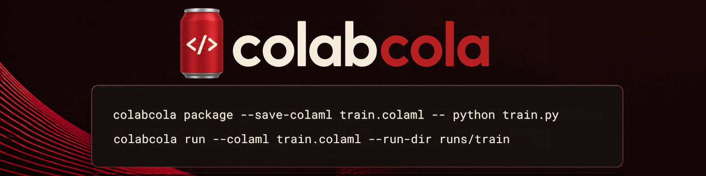

<p align="center">
  
</p>

Colab Cola packages Python scripts, modules, dependencies, and inputs into reproducible jobs. Submit them to Google Colab, monitor execution, and recover verified results from Google Drive — without building a notebook launcher yourself.

```bash
python -m pip install colabcola
```

Requires Python 3.12+. See [Development](https://github.com/dependanz/colabcola/blob/main/docs/DEVELOPMENT.md) for source installation and testing.

## Quick start

**1. Connect your Google account**

```bash
colabcola login --profile research
```

Colab Cola guides you through execution-project setup and authorization. New profiles use the bundled production Desktop OAuth client by default; providing your own is optional. First-time Google consent and some Console steps require your participation. [Setup guide](https://github.com/dependanz/colabcola/blob/main/docs/USER_SETUP.md)

**2. Package an existing Python workload**

```bash
colabcola package --profile research \
  --save-colaml experiment.colaml -- python train.py
```

The packaging guide collects data, dependencies, hardware needs, outputs, and optional checkpoint configuration. It creates a `.colajob` plus a reusable `.colaml` recipe, without executing your code.

**3. Run it on Colab**

```bash
colabcola run --profile research \
  --colaml experiment.colaml \
  --run-dir ./runs/experiment-1
```

Colab Cola checks the job and account, stages inputs, supervises the Colab runtime, publishes results to Drive, verifies recovered files, and releases the runtime it owns. Keep the supervising computer online while the run is active.

To prepare offline, add `--prepare-only`. To verify launch prerequisites without uploading or allocating compute, use `--preflight-only`. Repeating the **same command with the same run directory** reconnects to the existing run rather than starting a new one.

## What Colab Cola provides

| Capability | Description |
| --- | --- |
| **Python-first jobs** | Package scripts, modules, local files, pip requirements, and wheels. |
| **Managed runtime lifecycle** | Allocate, execute, monitor, and release Colab runtimes within declared bounds. |
| **Durable results** | Persist logs, checkpoints, and artifacts to Google Drive with integrity verification. |
| **Failure recovery** | Resume checkpoint-aware workloads on a replacement runtime after confirmed runtime loss. |
| **Repeatable workflows** | Reuse `.colaml` recipes, named account profiles, and durable run journals. |
| **Automation-friendly output** | Structured command results alongside human-readable terminal progress. |

```text
Python workload + inputs
          │
          ▼
  colabcola package ──► .colajob / .colaml
                               │
                               ▼
                       colabcola run
                               │
                               ▼
                        Google Colab
                               │
                               ▼
                  Google Drive + verified results
```

## Beyond batch jobs: a compute connection

Colab Cola is being developed as a **connection between local applications and remote compute**. Its Python job runner, verified artifact transport, and automatic checkpoint recovery remain core capabilities. Future interactive sessions would also carry input events, rendered frames, and other application I/O across that connection, with provider-independent transports.

The experimental bridge now includes a local graphics/input demo and an opt-in managed T4 renderer using Colab's authenticated Jupyter file transport. A first live T4 test established remote CUDA rendering, input acknowledgement, and owned-runtime cleanup, but showed only **0.3–0.7 FPS** using the preliminary polling transport. This is not general application virtualization. See [Interactive bridge](docs/INTERACTIVE_BRIDGE.md) for commands, tests, and remaining work.

## Platform support

| Host platform | Status for v0.1.0 |
| --- | --- |
| **Windows / PowerShell** | Live-tested: installation, login, CPU execution, artifacts, automatic checkpoint recovery, and owned-runtime cleanup. |
| **Ubuntu via WSL2** | Previously tested for managed execution and recovery; WSL2 is optional for Windows users. |
| **Native Linux** | Expected to work; independent release validation pending. |
| **macOS** | Not yet supported for managed login and execution. |

**Requirements:** Python 3.12 or newer, a Google account with access to Colab and Drive, and any one-time OAuth/Cloud project setup described in the [setup guide](https://github.com/dependanz/colabcola/blob/main/docs/USER_SETUP.md). Accelerator availability depends on Google Colab. The Windows recovery acceptance test used CPU runtimes; it does **not** establish that every GPU or runtime configuration works.

Checkpoint recovery is opt-in: your workload must write restorable state and accept a checkpoint manifest. A runtime lost before publishing its latest checkpoint cannot recover its unsaved in-memory progress. Compute limits are bounded requests, not guaranteed billing ceilings.

## Documentation

| Guide | Contents |
| --- | --- |
| [First-time setup](https://github.com/dependanz/colabcola/blob/main/docs/USER_SETUP.md) | Illustrated Google account, OAuth, Cloud project, and login walkthrough. |
| [Packaging](https://github.com/dependanz/colabcola/blob/main/docs/PACKAGING.md) | `.colajob` format, dependencies, inputs, outputs, and checkpoints. |
| [Recipes and managed workflows](https://github.com/dependanz/colabcola/blob/main/docs/RECIPES.md) | `.colaml`, run directories, offline preparation, and automation. |
| [Execution and recovery](https://github.com/dependanz/colabcola/blob/main/docs/LIFECYCLE.md) | Supervisor behavior, Drive persistence, failure recovery, and limits. |
| [Legacy controller](https://github.com/dependanz/colabcola/blob/main/docs/LEGACY_CONTROLLER.md) | Earlier notebook-based/manual execution workflows. |
| [Development](https://github.com/dependanz/colabcola/blob/main/docs/DEVELOPMENT.md) | Local builds, tests, and contribution workflow. |
| [Design](https://github.com/dependanz/colabcola/blob/main/docs/DESIGN.md) | Technical architecture and integrity contracts. |

## Development

Colab Cola is distributed as a Python package. Release checks cover clean wheel/source installs, complete regression tests, platform behavior, license notices, and the verified runtime lifecycle. See [Development](https://github.com/dependanz/colabcola/blob/main/docs/DEVELOPMENT.md) and [Packaging](https://github.com/dependanz/colabcola/blob/main/docs/PACKAGING.md) for current details.

Colab Cola is an independent project and is **not affiliated with or endorsed by Google**. Google Colab and Google Drive remain subject to their own availability, policies, and limits.
