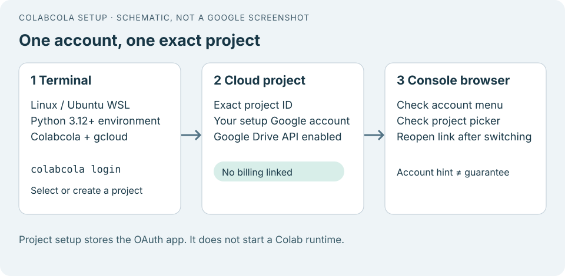
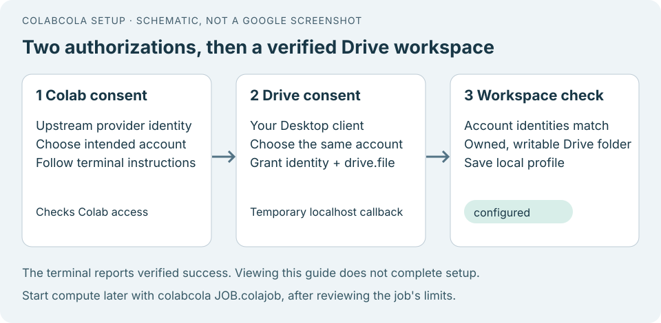
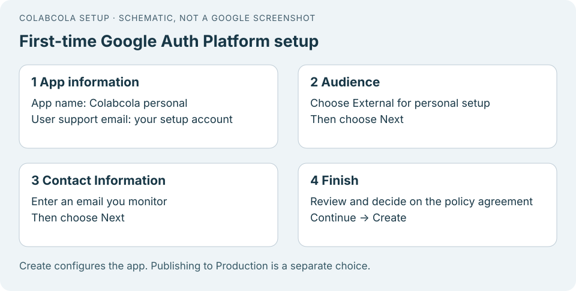
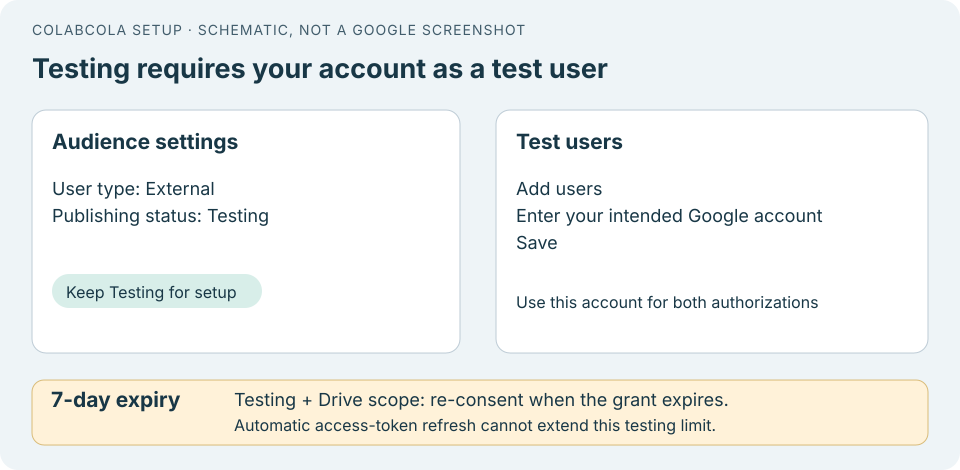
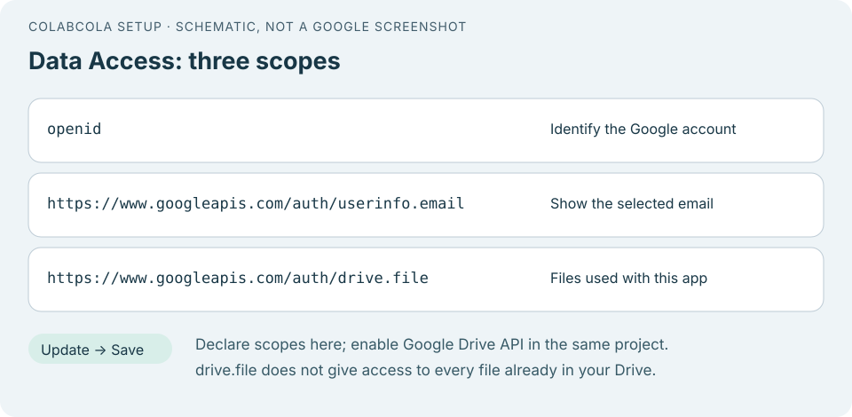
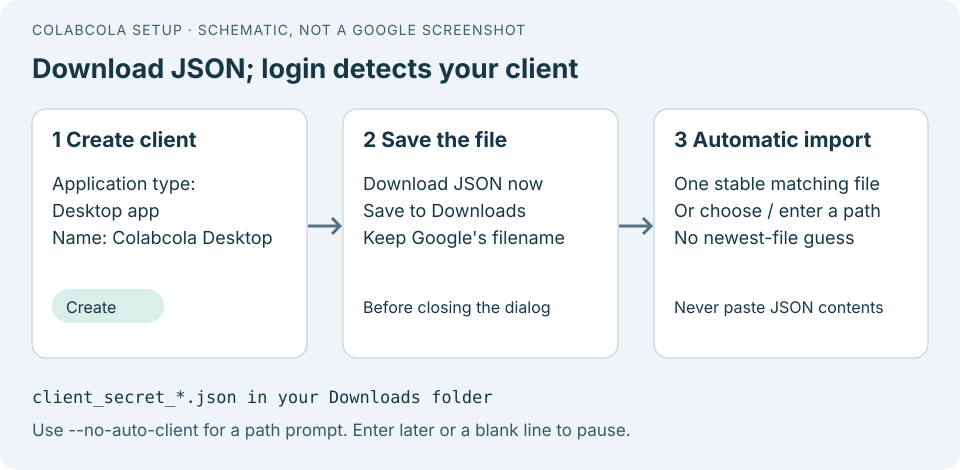

# Colab Cola — User setup

[← Back to the main README](../README.md)

Configure your Google account, package a Python workload, and run it in Colab.
This guide preserves the detailed first-time setup, troubleshooting, and
illustrated Google Auth Platform steps. The diagrams are **schematics**, not
live screenshots of Google's console.

> **Default v0.1.0 login:** New profiles use the bundled production Desktop OAuth client.
> You do not need to create a personal OAuth app or download client JSON.

## First-time setup

This is the detailed setup walkthrough for Colab Cola. Keep this guide
open alongside the login terminal. The illustrations are **schematics, not
screenshots of Google Console**; Google can change labels or layout. The terminal
reports actual verification results, while Console steps described as manual
remain your responsibility.

Native Windows PowerShell and Ubuntu WSL have passed live CPU execution and recovery
checks. Native Linux and macOS remain unverified for the first release. Packaging is
offline; login checks accounts and creates or reuses a Drive folder. Only a later
run command allocates compute.

### 1. Install in the environment that will supervise runs

Use Python 3.12 or newer in a dedicated virtual environment. Install using `python -m pip install colabcola` or a wheel built
from a trusted source checkout.

**Windows PowerShell:**

```powershell
py -3 -m venv .venv
.\.venv\Scripts\python.exe -m pip install colabcola
.\.venv\Scripts\colabcola.exe --help
```

**Linux or Ubuntu WSL:**

```bash
python3 -m venv .venv
. .venv/bin/activate
python -m pip install colabcola
colabcola --help
```

For a local wheel installation, substitute its path for `colabcola`
in the `pip install` command. Verify the environment's Python version
is 3.12 or newer before installing.

For automatic Google Cloud project setup, install the
[Google Cloud CLI](https://cloud.google.com/sdk/docs/install) on **the same host**
and verify `gcloud --version`. Colab Cola keeps its Cloud SDK configuration
separate from your usual `gcloud` defaults; it does not require `gcloud init`.
If the CLI is unavailable, first-time login can guide manual Console setup.

**Expected result:** `colabcola --help` opens, and `gcloud` is available if you
chose automatic project setup. Cloud resources have not yet been allocated.

### 2. Choose a profile, start login and select the project

Use a new, unused name for a fresh setup. The example `research` stores this login at
`~/.colabcola/configs/research`, separately from every other profile:

```bash
colabcola login --profile research --status
# For an unused name, expect state: not_configured.
colabcola login --profile research
```

If status already reports a configured login, choose another unused name for a
fresh start. Repeating login with an existing name reuses its saved setup;
`--force` renews consent and does not reset it. Status is local and does not
contact Google. The selected profile name and absolute `config_home` identify
which directory each command uses. Creating a profile does not select it for
future commands: keep `--profile research` in the examples below, or set a
[session preference](#profile-selection-and-existing-logins).



Follow the terminal's Cloud sign-in instructions. Use the Google account you intend
to use for **Colab, Drive and automatic project setup**. The browser account menu
might initially show another signed-in account.

The terminal offers a discovered Colabcola-managed project or a new dedicated
project. You can also name an existing project you control:

```bash
colabcola login --profile research --project YOUR_EXACT_PROJECT_ID
```

Use the **project ID**, not its display name or numeric project number. For a new
project, Colabcola records the chosen ID before requesting setup approval. Read the
confirmation naming the project and Drive API change.

Automatic setup checks access, verifies that billing is unlinked, and enables
Google Drive API. It refuses linked, enabled or unverifiable billing. It never
links billing or enables a paid compute service. Your Colab subscription and
compute units remain separate.

If you choose the manual route:

1. Open the [project selector](https://console.cloud.google.com/projectselector2/home/dashboard)
   and select or create the exact project ID saved by the terminal.
2. Open [Billing](https://console.cloud.google.com/billing/linkedaccount), verify
   the selected project, and check that **no billing account is linked**. Do not
   enroll in a free trial or attach a card for this setup.
3. Open [Google Drive API](https://console.cloud.google.com/apis/library/drive.googleapis.com),
   verify the same project, and choose **Enable** if needed.
4. Return to the terminal and confirm those steps when it asks.

These confirmations are recorded as `self_reported`, not independently checked.
Later OAuth and Drive access checks still run online.

**Expected result:** the terminal prints the exact selected project. Automatic
checks are recorded as `online_verified`; manual confirmations as
`self_reported`. Neither means that a GPU has been allocated or is available.

The execution project is distinct from the bundled OAuth publisher project.
Follow the terminal instructions for Google Cloud and Drive API setup.

### 3. Complete both Google authorizations



1. **Colab:** follow the terminal instructions using the pinned upstream provider's
   application identity. Enter an authorization code only into the terminal if
   requested. Colabcola verifies access and lists assignments without allocating.
2. **Drive:** authorize the bundled Desktop client (or your explicitly
   selected custom client). Select the same Google account
   and grant identity and per-file Drive access. Keep the terminal open for its
   temporary localhost callback.

The two flows have different app identities, so two consents are expected.
Colabcola compares the stable Google identity from both grants. For automatic
project setup, the verified Cloud setup account must match too. An account hint
does not replace these checks.

The Drive flow uses browser authorization with PKCE and a loopback callback.
[Google Desktop OAuth](https://developers.google.com/identity/protocols/oauth2/native-app).

**Expected result:** both grants are usable and belong to the same account.
Declined scopes or organization restrictions stop setup with an actionable error.

### 4. Confirm success and understand what was checked

After successful account checks, login creates a marked `colabcola` Drive folder,
or verifies the exact folder recorded in the profile. It checks ownership,
not-trashed status and permission to add children before committing the profile.

The terminal reports `state: configured` and the Drive parent ID. It also reports
the project-check evidence level. An existing assignment is reported, not cancelled.
No runtime starts during login.

```bash
colabcola login --profile research --status
```

This is an **offline configuration check**: `credentials_checked: false` and
`network_accessed: false` mean it did not test current authorization or availability.
A successful prior login and a current offline configured status are different
claims. Actual run preflight checks access again before staging.

This named profile's root is `~/.colabcola/configs/research`. It contains private
authorization files, nonsecret profile/setup metadata and the isolated gcloud
management configuration. Keep it outside your workload directory. Tokens and
host-only helper configuration do not belong in portable jobs. Do not hand-edit
token or identity files. Existing login directories remain supported; see
[profile selection and existing logins](#profile-selection-and-existing-logins).

### 5. Package an ordinary script or module

From the directory where you normally run your code:

```bash
colabcola package --profile research --save-colaml training.colaml -- python train.py --data data
# A module is equally valid:
colabcola package --profile research -- python -m myproject.train
```

Answer the questions about dependencies, data, GPU, outputs, checkpoints and time.
Review inferred dependencies: dynamic imports and arbitrary file access cannot be
discovered reliably. A checkpoint setting only enables useful continuation if your
program actually writes checkpoints and knows how to resume them.

Packaging creates a `.colajob`, frozen `.files` inputs and local `.run.json`
settings. A `.colaml` is reusable TOML configuration. It does not run the workload,
upload, allocate or authorize a future launch. See [PACKAGING.md](PACKAGING.md).

For a small, explicitly bounded first CPU job, save this ordinary script as
`hello_colab.py` in a new project directory:

```python
import json
import platform
from pathlib import Path

print("Writing a small result", flush=True)
Path("outputs").mkdir(exist_ok=True)
Path("outputs/hello.json").write_text(
    json.dumps({"message": "Hello from Colab", "python": platform.python_version()}),
    encoding="utf-8",
)
print("Finished", flush=True)
```

Save `hello.colaml` alongside it:

```toml
commands = [["python", "hello_colab.py"]]
project = "."
inputs = []

[environment]
dependencies = []

[compute]
gpu = false

[outputs]
include = ["outputs/**"]
checkpoints = []
maximum_bytes = 1048576

[limits]
timeout_seconds = 60
max_seconds = 300
max_runtimes = 1
```

Then package and inspect the prepared plan without a launch:

```bash
colabcola package --profile research --colaml hello.colaml --non-interactive
colabcola --profile research --prepare-only hello_colab.colajob
```

**Expected result:** a CPU-only plan with one runtime maximum, a 300-second total
bound and a 1 MiB output allowance. Five minutes is a bound, not a guarantee that
Colab setup will finish within it.

### 6. Run and recover results

When you are ready to use compute, run the prepared example:

```bash
colabcola --profile research hello_colab.colajob
```

The single command handles preflight, upload, allocation, execution, progress,
verified artifact recovery and owned-runtime release. Preflight checks the frozen
job and plan, controller integrity, local recovery space, active Colab assignments,
Drive token lifetime and the destination folder. An already active assignment
normally prevents allocation.

For GPU jobs, Colabcola checks and reports the received model and memory floor.
An accelerator request does not guarantee Google will provide one.

Keep the supervising computer awake and connected. At the end, inspect the final
outcome, printed verified-results directory and runtime-release result. A completed
upload or a released runtime alone does not establish workload success.

After a local interruption, repeat the **same job and run directory** to reconcile
its journal and remaining allowance. Do not use a new directory as a recovery
shortcut. A completed journal is reused rather than silently launching again.

For a genuinely new run from saved settings, use a new directory outside the source
project and existing managed-job folders:

```bash
colabcola run --profile research --colaml hello.colaml \
  --run-dir "$HOME/colabcola-runs/hello-002" --non-interactive
```

This command **starts another bounded run**. See [LIFECYCLE.md](LIFECYCLE.md) for
recovery, budgets, output verification and release behavior.

### Profile selection and existing logins

Profiles are separate local login directories, not an automatic account switch.
`--profile NAME` works after `login`, `package` or `run`; put it before the job
path for direct execution:

```bash
colabcola login --profile research
colabcola package --profile research -- python train.py
colabcola --profile research train.colajob
colabcola run --profile research --colaml training.colaml --run-dir "$HOME/colabcola-runs/training-2"
```

A name is 1–64 lowercase letters, digits, underscores or hyphens, beginning with
a lowercase letter or digit. Windows reserved device names such as `con` and
`nul` are rejected. Each named profile lives at `~/.colabcola/configs/NAME`.
Names identify local directories; Google authorization still establishes the
actual account. There is no persistent active-profile selection.

For plain commands in one shell, set a session preference:

```bash
# Clear this only if you intend to stop using a custom configuration root.
unset COLABCOLA_CONFIG_HOME
export COLABCOLA_PROFILE=research
colabcola login --status
colabcola package -- python train.py
colabcola train.colajob
```

Selection uses the following order:

1. Explicit `--profile NAME`, or `login --config-home PATH`. These two flags cannot
   be combined. An explicit profile overrides environment selections.
2. `COLABCOLA_CONFIG_HOME`, preserving existing custom-directory workflows.
3. `COLABCOLA_PROFILE`.
4. The existing `~/.config/colabcola` directory, if present.
5. `~/.colabcola/configs/default` for a new installation.

No legacy files are moved, copied or deleted. An existing environment-selected
root stays selected until you change that environment or supply an explicit
profile. `login --config-home PATH` applies only to that invocation; keep
`COLABCOLA_CONFIG_HOME` set to the same path for subsequent commands. Status
reports the absolute `config_home` and the profile name when using a named profile.

Packaging is offline and does not bind the portable job to an account. Select the
intended profile when preparing or executing it. Prepared journals and existing
explicit helpers retain their absolute configuration paths; they are not migrated.
Use the same profile when resuming a run. The normal managed profile workflow
checks the saved helper binding and refuses a different selection for an already
prepared journal. Older custom helpers retain their own configuration and cannot
be assumed to enforce the same account checks.

### Resume, renew or use a separate account

Ordinary recovery uses the same virtual environment and profile:

```bash
colabcola login --profile research
colabcola login --profile research --status
# When Google requires new consent:
colabcola login --profile research --force
```

`--force` requests authorization again. It does not reset the profile or permit
replacement of an existing account's project/client. For a deliberate separate
account/project, choose a new, unused name and follow the setup walkthrough:

```bash
colabcola login --profile second-account --status
# Continue here only for the new profile you intend to configure.
colabcola login --profile second-account
```

Keep old profiles intact. Do not migrate by copying token files or editing account
IDs. Switching a local profile does not change the account selected in your browser.

Short-lived access tokens renew automatically while the refresh token is valid.
External / Testing with Drive needs new consent after seven days. Revocation,
organization policy and other Google conditions can also invalidate refresh
tokens. [Refresh-token expiration](https://developers.google.com/identity/protocols/oauth2#expiration).

If you use your own OAuth app, changing it to **Production** is a separate manual Console
decision. This removes the Testing-specific seven-day rule, not all possible
expiry or policy restrictions. `drive.file` is non-sensitive: Google does not
require sensitive-scope review for this scope set. Displaying a public app's
name/logo has brand-verification requirements. Colabcola neither publishes the
app nor represents completion of Google's review.
[Verification distinctions](https://support.google.com/cloud/answer/13463073),
[brand requirements](https://developers.google.com/identity/protocols/oauth2/production-readiness/brand-verification).

### OAuth callbacks on WSL and remote terminals

When using WSL on a Windows laptop, the Windows browser can normally reach a WSL service
through `localhost`. Keep login running while following its Google authorization
instructions. If the OAuth page does not open automatically, use the authorization
URL printed in the terminal.
[Microsoft's localhost guidance](https://learn.microsoft.com/en-us/windows/wsl/networking).

The Drive OAuth flow listens temporarily on a loopback callback port. On a remote
Linux machine, that loopback address refers to the remote machine, not your laptop.
Remote authorization can require an explicit SSH forward of the callback port,
using the same local port that Google's redirect URL expects, and a browser on
your local machine. Do not expose the callback on a public interface.

The present workflow is not a promise of unattended first-time authorization on a
browserless host. Perform first setup on the host where your browser
can reach the OAuth callback (native Windows, Linux or WSL). If the callback cannot connect, resolve that connection
instead of sharing authorization codes or tokens with someone else.

### Troubleshooting

| Symptom | Next action |
| --- | --- |
| Wrong account, missing project or missing support email | Verify the browser account, switch it, then reopen the exact project link. Try a separate browser profile if needed. |
| gcloud not found | Install it in the same Windows/Linux/WSL environment, or choose the manual route and recognize its self-reported checks. |
| Cloud project inspection/creation error | Read the terminal's classified cause. Resolve terms, permission, policy or quota as appropriate. Retry the same saved ID; an ambiguous denied lookup is not proof of absence. |
| Billing linked or unknown | Use a dedicated unbilled project in a new configuration. Colabcola does not change billing for you. |
| Drive `SERVICE_DISABLED` | Enable Drive API in the exact imported client's project. Allow propagation, then retry. More consent alone does not enable an API. |
| Testing `access_denied` | Add the exact consent account under Audience → Test users. Also check declined consent or administrator policy. |
| `invalid_grant` after earlier success | Run `colabcola login --profile research --force` in the same root (substitute your profile name). Testing expiry is one cause; revocation or account policies can also apply. |
| Wrong client type/project | Import the Desktop JSON from the saved project. Do not substitute a web/device client. |
| Multiple matching clients | Choose the numbered candidate you intended or enter its path. Identical validated copies coalesce; distinct clients are never selected by recency. |
| Automatic scan is incomplete | An unreadable/partial matching file or scan limit prevents automatic selection. Use a path or `--no-auto-client` for manual selection; no folder-wide search is attempted. |
| Downloaded client is not detected | Keep Google's `client_secret_*.json` name in the current user's Downloads. Renamed files, other folders or unresolved Windows Downloads need an explicit path; WSL accepts a quoted Windows path or its `/mnt/c/...` equivalent. |
| Paused with later, blank input or Ctrl+C | Repeat login in the same configuration. The selected project is retained; a completed download can be detected then, or supplied with `--drive-client PATH`. |
| Colab and Drive accounts differ | Re-consent with `login --force`, selecting the same intended account for both and matching automatic Cloud setup. |
| Folder inaccessible or ambiguous | Preserve the profile. Check ownership, trash and permissions. `--drive-parent ID` requires a folder already visible to this app; an ID alone is not a Drive grant. |
| Runtime already active | Check its owning job or Colab session. Login does not cancel it; preflight normally refuses a second allocation. |
| Invalid setup record or client replacement refused | Preserve the current root and use a new configuration for migration; do not edit saved bindings. |

Creating a personal Desktop OAuth client is optional; the default client is bundled.
Google Console client creation applies to the custom-client workflow. [Google's OAuth best practices](https://developers.google.com/identity/protocols/oauth2/resources/best-practices).

These illustrated instructions and manual confirmations are not
evidence of a successful login or run. Use the terminal's actual verification
results and the managed run's final journal and recovered artifacts.

## Optional: Use your own Desktop OAuth client

The following Console steps are unnecessary for ordinary first-time login.
Use `--drive-client PATH` to supply your own Desktop client or
`--no-auto-client` for manual selection. An explicitly supplied client
may belong to a different Cloud project from the execution project.
The detailed steps below show the same-project alternative.

### Check the Console account before editing

Use the project-specific links printed by the login terminal.

1. Check the top-right Google account menu.
2. Check the project picker shows the exact selected project ID.
3. If you switch accounts, reopen the **same project-specific link** afterward.
4. If multi-account selection stays confusing, use a separate browser profile or
   private window signed in only to the intended account.

The links may include an account hint, but it is **best-effort, not enforced
account selection**. Google documents that simultaneous sessions can use a
different default account. [Multiple Google accounts](https://support.google.com/accounts/answer/1721977).

**Expected result:** the intended email and exact project are visible before you
change settings. Colabcola cannot inspect that Console tab for you.

### Complete Google Auth Platform's first-time forms



Open [Google Auth Platform](https://console.cloud.google.com/auth/overview) in the selected project. If this project already has an app, inspect its
settings and continue at the matching step. If it shows **Get started**:

1. **App information:** enter a recognizable name such as `Colabcola personal`;
   select your own **User support email**; choose **Next**.
2. **Audience:** select **External**; choose **Next**. Internal is available only
   for an associated Workspace/Cloud Identity organization.
3. **Contact Information:** enter an email you monitor; choose **Next**.
4. **Finish:** personally review Google's policy. If you agree, select the
   agreement, then **Continue** and **Create**.

If your email is absent from the support-email dropdown, revisit the browser
account selection. Creating this app configuration does not publish it to
Production. Colabcola does not accept terms for you.
[Google's setup instructions](https://developers.google.com/workspace/guides/configure-oauth-consent).

**Expected result:** Google Auth Platform now shows app settings.

### Configure Audience and your test user



Open [Audience](https://console.cloud.google.com/auth/audience), keep **Testing**, then under **Test users** choose **Add users**.
Add the exact Google account you intend to use for Colab and Drive, then **Save**.

Testing can show an unverified/test-access warning even for this personal app.
Check that it identifies the app you just configured and requests the intended
permissions before deciding whether to proceed.

**Testing grants containing Drive access expire after seven days**, including
their refresh tokens. The exception for identity-only scopes does not apply to
`drive.file`. Access-token renewal cannot extend that seven-day grant.
[Google's Audience rules](https://support.google.com/cloud/answer/15549945).

**Expected result:** External / Testing and the intended account appear in Audience.

### Add the exact scopes



Open [Data Access](https://console.cloud.google.com/auth/scopes) and choose **Add or remove scopes**. Select these three for this app:

```text
openid
https://www.googleapis.com/auth/userinfo.email
https://www.googleapis.com/auth/drive.file
```

Choose **Update**, then **Save** as offered by Console. Identity labels may be
grouped under basic account information.

These identity scopes let login check the selected account. `drive.file` permits
files created or explicitly made available to this app; it does not expose your
entire existing Drive. Supplying an existing folder's ID alone does not grant
access. [Drive scope definitions](https://developers.google.com/workspace/drive/api/guides/api-specific-auth).

Declaring a scope does not enable its API. If Drive scopes are missing or
`SERVICE_DISABLED` appears later, verify **Google Drive API** is enabled in this
exact client's project.

**Expected result:** all three strings are saved in Data Access. Login later checks
the scopes actually granted and whether the Drive API can be used.

### Create the Desktop client and download JSON immediately



Open [Clients](https://console.cloud.google.com/auth/clients) and choose **Create client**:

- **Application type:** Desktop app.
- **Name:** a recognizable name such as `Colabcola Desktop`.
- Choose **Create**, then **Download JSON** before closing the dialog.

Save to your current user's **Downloads** folder and keep Google's default
`client_secret_*.json` filename. Numbered duplicate downloads are supported.
Keep the login terminal open: once the matching file is stable, login can find
and import it without a path or an extra Enter.

Google shows the newly created client secret only at creation. Do not rely on
recovering the original file from a later view.
[Manage OAuth clients](https://support.google.com/cloud/answer/15549257).

A Desktop client does not need Web-application redirect fields here. The managed
workflow does not use a **TVs and Limited Input devices** client. If an optional
AI-powered-agent designation is offered, read its explanation and decide according
to your use; Colabcola does not select it for you.

Keep the JSON, codes and tokens out of source control, chat and job inputs.
Google's forms, policy agreement and OAuth consent remain manual steps;
automatic file detection does not create or publish the OAuth client.

**Expected result:** a downloaded Desktop OAuth JSON from the selected project,
ready for automatic detection or an explicit path. Replacing a client already
bound to a working profile requires a separate configuration.

### Let login detect the download, or give its path

After the project is selected and login needs a Desktop client, it checks the
current user's Downloads folders for files named `client_secret_*.json`.
On native Windows, use the file path shown in your Downloads folder if automatic
detection is unavailable. The `--drive-client PATH` option imports that Desktop
OAuth JSON without copying any refresh tokens.

On Linux it uses the configured XDG Downloads folder or `~/Downloads`; in WSL
it also checks the current Windows user's Downloads folder when that location
can be resolved. It does not search other profiles, recurse into subfolders, or
scan your entire computer.

Candidates must be regular, stable files containing a valid Google **Desktop**
client for the exact selected project. Renamed files or files saved elsewhere
need an explicit path. Multiple copies of the same validated client count as
one choice. If distinct valid matching clients exist, login offers numbered
choices or a file path instead of guessing which is newest.

In an interactive Linux/WSL terminal, login can watch for a new download and
continues automatically after two matching complete checks about one second
apart establish one choice. This wait has **no automatic timeout**. Enter
`later`, submit an empty line, or press Ctrl+C to pause with the project saved.

You can still type a file path and press Enter. Submitted input takes priority
over automatic selection. If detection completes while you have only partially
typed a path, that unfinished text is discarded before the next authorization
prompt. The terminal warns about this behavior; use `--no-auto-client` for a
strictly manual path prompt.

If the first scan encounters an unreadable or partial matching file, or reaches
a scan limit, login falls back to a manual path rather than assuming its result
is complete. During an active watch it waits for incomplete downloads to settle.

With redirected/noninteractive input, login checks for an already stable unique
client but does not wait in the background for a future download. If it cannot
select one, the file-path prompt remains the fallback.

To choose the file explicitly:

```bash
colabcola login --profile research --drive-client "/mnt/c/Users/YOUR_WINDOWS_USER/Downloads/client.json"
```

Or disable automatic detection and use only the terminal's path prompt:

```bash
colabcola login --profile research --no-auto-client
```

At that prompt enter the path, **not the JSON contents**. In WSL either form works:

```text
"C:\Users\YOUR_WINDOWS_USER\Downloads\client.json"
/mnt/c/Users/YOUR_WINDOWS_USER/Downloads/client.json
```

Native Windows paths work too. Quote paths containing spaces. Symlinks and junctions
are refused. An explicit `--drive-client` bypasses discovery; a usable already
imported client is reused without searching Downloads.

After interruption, repeat `colabcola login --profile research` in the same
configuration. It retains the selected project and can detect the download then. An existing account's
missing client can be restored only when it matches the recorded client digest;
finding another client for that project does not authorize replacing the binding.
The original download is left in place.

**Expected result:** the terminal reports the selected file path and project,
validates it, and advances to Colab authorization. No runtime starts.
